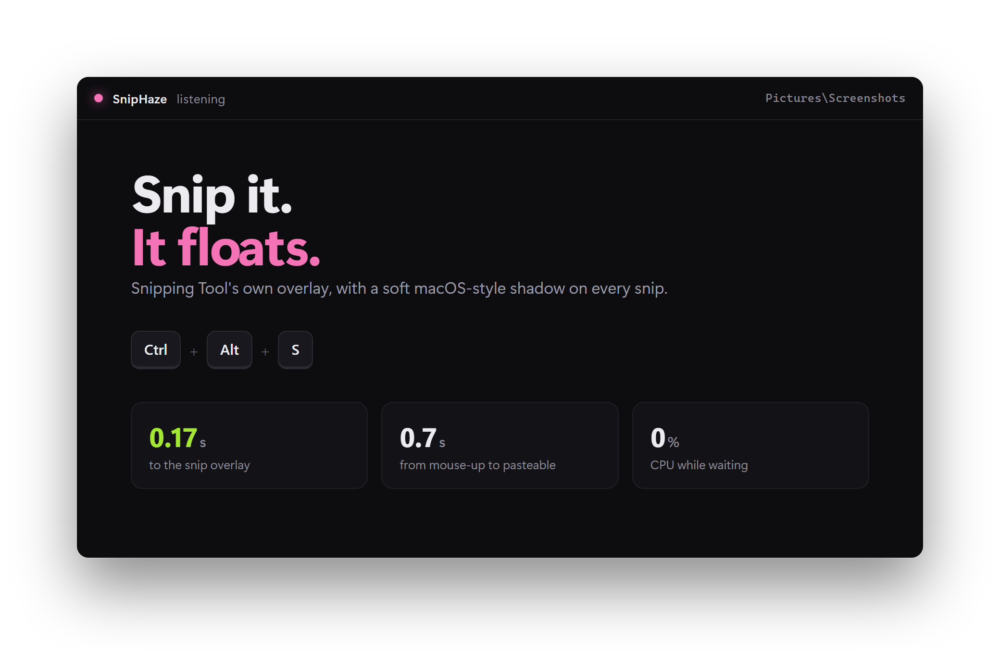
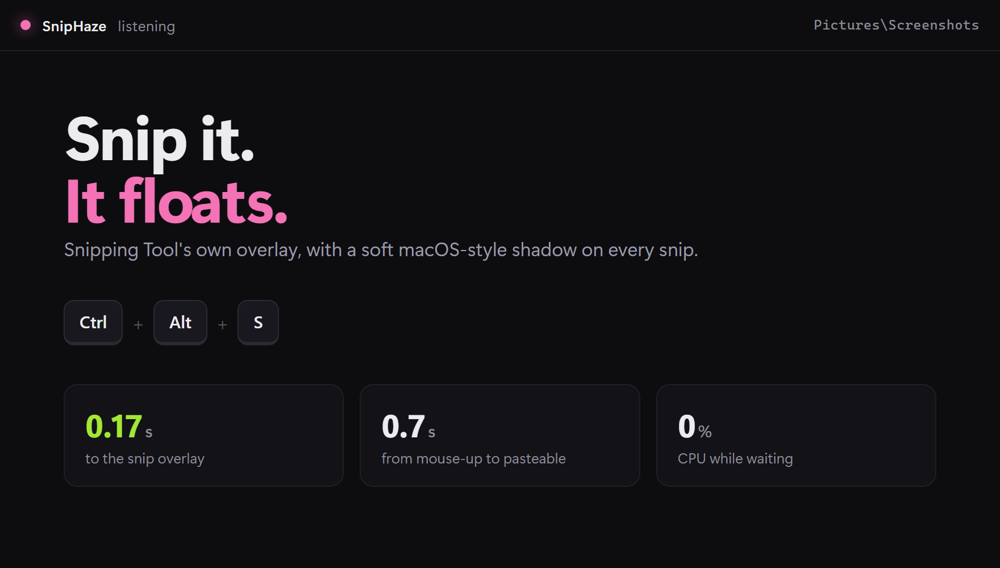

<div align="center">

# SnipHaze

**macOS-style screenshots on Windows.**<br>
Press a shortcut, snip with Windows Snipping Tool, and paste a snip that floats on a soft shadow.




</div>

## Before and after

<table>
<tr>
<td align="center" width="50%"><b>Snipping Tool</b></td>
<td align="center" width="50%"><b>SnipHaze</b></td>
</tr>
<tr>
<td></td>
<td></td>
</tr>
</table>

On macOS a window screenshot floats on a transparent canvas with a soft shadow, and it looks good wherever you paste it. On Windows you get a flat rectangle.

SnipHaze adds the macOS look without replacing anything. You keep Windows Snipping Tool, its overlay and all its modes (rectangle, window, freeform, full screen). Every snip comes back with the backdrop already applied.

## Features

- **Fast:** the overlay appears about 0.17s after you press the shortcut. Your snip is ready to paste about 0.7s after you let go of the mouse.
- **The backdrop:** the canvas is transparent, with 12px rounded corners, a soft `0 30px 60px` shadow at 45% black and a 1px edge. On a 200% display everything scales up to match.
- **Pastes cleanly:** the clipboard gets a PNG with real transparency for Discord, Slack, Figma, Notion and browsers. Apps that can't paste transparency get a version on white.
- **Saves too:** the file in `Pictures\Screenshots` becomes the backdrop version. The plain original is copied to `Screenshots\Originals` first.
- **Light to run:** SnipHaze sleeps until you press the shortcut. It uses no CPU and about 25 MB of memory while waiting.
- **Plain snips still work:** Win+Shift+S still gives you an ordinary snip.

## Install

You need **Windows 11** with Snipping Tool and **[Python 3.10 or newer](https://www.python.org/downloads/)**.

```powershell
git clone https://github.com/Just-Haze/sniphaze.git
cd sniphaze
.\install.ps1
```

The installer does the following:

- adds [Pillow](https://pypi.org/project/Pillow/) if it's missing
- starts SnipHaze
- adds SnipHaze to your Startup folder, so it starts with Windows

No admin rights are needed, and no system settings are changed.

> If PowerShell says running scripts is disabled, use:
> `powershell -ExecutionPolicy Bypass -File .\install.ps1`

## Use

| Press | You get |
|---|---|
| **Ctrl+Alt+S** | A snip with the backdrop, on the clipboard and in `Pictures\Screenshots` |
| Win+Shift+S | A plain snip, exactly as before |
| Esc (while snipping) | Nothing: the snip is cancelled and SnipHaze goes back to waiting |

### Change the shortcut

```powershell
.\install.ps1 -Hotkey "CTRL+SHIFT+F9"
```

A shortcut is one key plus any of `CTRL`, `ALT`, `SHIFT` and `WIN`. The key can be:

- a letter or digit
- `F1` to `F24`
- `PRINTSCREEN`, `PAUSE`, `SCROLLLOCK`, `SPACE` or `INSERT`

Letters, digits and other typing keys need `CTRL`, `ALT` or `WIN`, so the shortcut can't take over normal typing.

### Uninstall

```powershell
.\install.ps1 -Uninstall
```

This stops SnipHaze and removes it from Startup. Your screenshots are left alone.

## How it works

```
Ctrl+Alt+S ──► SnipHaze presses Win+Shift+S ──► Snipping Tool's overlay
                                                       │ you snip
                                                       ▼
paste ◄── backdrop on the clipboard + saved file ◄── Snipping Tool copies the snip
```

1. **Shortcut:** a hidden window registers the shortcut with `RegisterHotKey`, so Windows wakes SnipHaze the moment you press it. A shortcut set on a `.lnk` file would be cheaper, but Windows can hold it up to 3 seconds behind any app that has stopped responding.
2. **Overlay:** SnipHaze presses Win+Shift+S for you, the fastest way to open Snipping Tool's overlay. If that doesn't open it, SnipHaze falls back to Snipping Tool's `ms-screenclip:` link.
3. **Waiting for the snip:** SnipHaze waits for `SnippingTool.exe` to copy the snip. Snipping Tool copies each snip twice, about 130ms apart, so SnipHaze waits for the clipboard to settle. If Snipping Tool copies again afterwards, the backdrop is put back.
4. **Backdrop:** Pillow draws the backdrop. SnipHaze puts the result on the clipboard first, then swaps it into the file Snipping Tool auto-saved. It finds that file by matching its pixels, so a screenshot from another app is never touched.

Pillow only loads once you start a snip, while you're still dragging. That keeps the idle process small.

## Troubleshooting

| Problem | Fix |
|---|---|
| "Ctrl+Alt+S is already used by another app" | Choose another shortcut: `.\install.ps1 -Hotkey CTRL+ALT+G` |
| Ctrl+Alt+S types a character instead | On some keyboard layouts Ctrl+Alt acts as AltGr. Choose another shortcut. |
| No original in `Screenshots` | Turn on **Automatically save screenshots** in Snipping Tool's settings. SnipHaze saves its own copy either way. |
| The shadow is hard to see in Discord | The shadow is black, so it barely shows on dark themes. On light backgrounds it shows clearly. |
| Anything else | Check `%LOCALAPPDATA%\SnipHaze\sniphaze.log`. It has one line per snip, with timings or the reason a snip was skipped. |

You can also run SnipHaze by hand:

```powershell
pythonw SnipHaze.pyw                                 # listen for Ctrl+Alt+S
pythonw SnipHaze.pyw --once                          # take one snip now
pythonw SnipHaze.pyw --quit                          # stop the running copy
python  SnipHaze.pyw --check --hotkey CTRL+ALT+G     # check that a shortcut is usable
```

## FAQ

**Does it change Snipping Tool?**
No. Snipping Tool stays exactly as Microsoft ships it. SnipHaze opens it and then works on what it copies.

**Does it run in the background?**
Yes, as one small process that waits for your shortcut. Windows only wakes it when you press the shortcut, so it uses no CPU in between. That's what makes it instant even when another app has frozen.

**Why Python instead of an .exe?**
A packed Python .exe has to unpack itself every time it starts, which would add delay. Run as plain Python, SnipHaze starts once and then just waits.

## Development

```powershell
python -m pip install pillow pytest
python -m pytest
```

To also test the real clipboard (this overwrites what's on it):

```powershell
$env:SNIPHAZE_CLIPBOARD_TEST=1; python -m pytest tests/test_winapi.py
```

```
SnipHaze.pyw           entry point (run with pythonw)
install.ps1            install, change shortcut, uninstall
sniphaze/
  __main__.py          one snip from start to finish, command line
  listener.py          the hidden window that owns the shortcut
  hotkey.py            "CTRL+ALT+S" -> what RegisterHotKey expects
  capture.py           opening the overlay and waiting for the snip (pure timing logic)
  backdrop.py          draws the shadow backdrop
  flow.py              clipboard formats, finding the auto-saved file
  saving.py            writes the backdrop file and keeps the original
  winapi.py            clipboard, keys, display scale, Screenshots folder (ctypes)
tests/                 pytest suite; timing logic runs against a fake clock
```

## Credits

The backdrop values come from the Shadow Backdrop mode in [opensnap](https://github.com/Just-Haze/opensnap).

## License

[MIT](LICENSE) © Just-Haze
